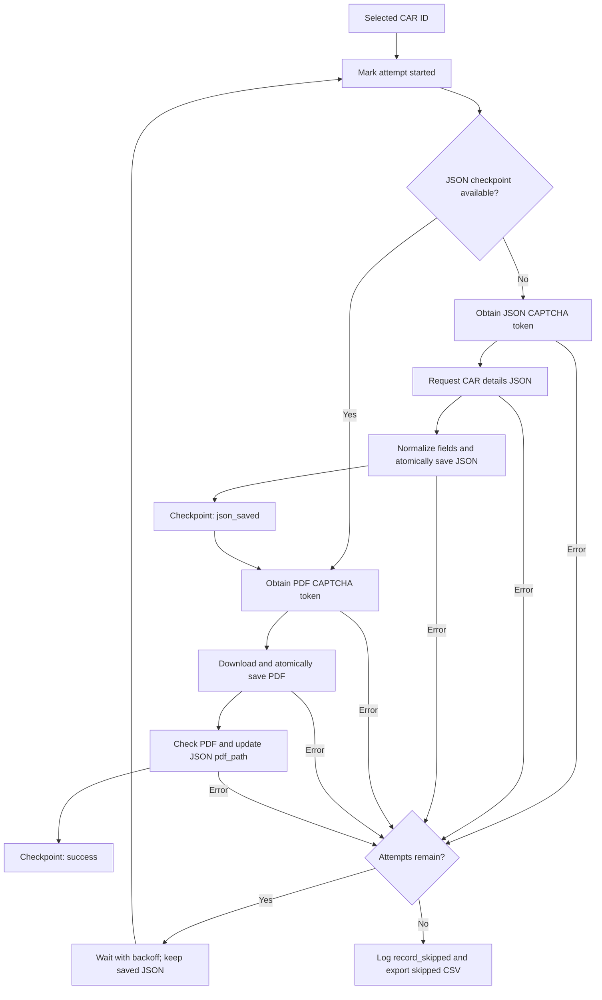

# Brazil CAR Scraper

A resumable Python scraper that collects public registration details and PDF
statements for properties in Brazil's **Cadastro Ambiental Rural (CAR)**, the
Rural Environmental Registry. The current command is configured for **Acre**.

Give the scraper a CSV containing CAR registration IDs (`cod_imovel`). For each
ID, it requests the property's details from the CAR consultation service, saves
the response as JSON with normalized English field names, and downloads the
official PDF statement, or *demonstrativo*. A record is complete only when both
files have been saved and passed the implemented checks.

The scraper uses direct HTTP requests and a paid CAPTCHA provider. CapSolver is
used in the examples; the code also supports 2captcha. No Chrome profile,
browser extension, Selenium or Playwright installation is needed.

## Contents

- [What it collects](#what-it-collects)
- [Requirements and installation](#requirements-and-installation)
- [Input CSV](#input-csv)
- [Quick start](#quick-start)
- [Understanding the command](#understanding-the-command)
- [Batch selection and more commands](#batch-selection-and-more-commands)
- [How the scraper works](#how-the-scraper-works)
- [Code flow and source files](#code-flow-and-source-files)
- [Outputs and JSON structure](#outputs-and-json-structure)
- [Status, retries and skipped records](#status-retries-and-skipped-records)
- [Stopping and resuming](#stopping-and-resuming)
- [Monitoring and timings](#monitoring-and-timings)
- [Troubleshooting](#troubleshooting)
- [Publishing the repository](#publishing-the-repository)
- [Current scope and limitations](#current-scope-and-limitations)

## What it collects

| Output | Contents |
| --- | --- |
| One JSON per CAR ID | Source response fields, property details, area totals, restrictions, selected fields under English keys, capture timestamp and PDF path. |
| One PDF per CAR ID | The PDF returned by the CAR statement endpoint. It is downloaded, not generated locally from the JSON. |
| Status manifest | Each input ID's progress, attempt count, saved paths and most recent error. |
| Skipped-record CSV | Records that remain incomplete after exhausting their retry allowance. |
| Logs and summary | Events, retry decisions and average request/CAPTCHA timings. |

The consultation page is <https://www.car.gov.br/#/consultar>. The endpoints used
by this implementation are configured in [constants.py](car_scraper/constants.py):

```text
JSON: https://www.car.gov.br/imovel/demonstrativo/{cod_imovel}/gerarComRecaptcha
PDF:  https://www.car.gov.br/pdf/demonstrativo/{cod_imovel}/gerarComRecaptcha
```

Each request includes a separately obtained `recaptchaResponse` token. A normal
record therefore needs two tokens: one for JSON and one for PDF. Retries can
require additional tokens. The CapSolver integration requests
`ReCaptchaV2TaskProxyLess`, a reCAPTCHA v2 token task.

## Requirements and installation

Requirements:

- Python 3.10 or newer. The project has been run with Python 3.12 on Windows.
- Internet access to the CAR website and the selected CAPTCHA provider.
- A provider API key with sufficient credits.
- Writable local storage for downloads and progress files.
- Optional, recommended: `curl.exe` or `curl` available on `PATH`. The HTTP client
  prefers curl when found and otherwise uses Python's `requests` library.

Download or clone the repository, open its root folder in a terminal, then create
a virtual environment and install dependencies. These examples use **Windows
PowerShell**:

```powershell
python --version
python -m venv .venv
.\.venv\Scripts\Activate.ps1
python -m pip install -r requirements.txt
```

The application dependency is `requests`; Python's standard library provides
CSV handling, JSON handling, worker threads and progress-file management.

If PowerShell prevents virtual-environment activation, you can use its Python
executable directly instead of activating it:

```powershell
.\.venv\Scripts\python.exe -m pip install -r requirements.txt
.\.venv\Scripts\python.exe -m car_scraper --help
```

### Configure the API key

Set your own CapSolver key in the same PowerShell terminal that will run the
scraper:

```powershell
$env:CAPSOLVER_API_KEY = "YOUR_CAPSOLVER_API_KEY"
```

This sets a variable for that terminal session. Set it again when opening a new
terminal. The scraper does **not** automatically load a `.env` file. Keep actual
keys out of source code, README examples and Git commits.

For 2captcha, set this variable and use `--captcha-provider 2captcha`:

```powershell
$env:TWO_CAPTCHA_API_KEY = "YOUR_2CAPTCHA_API_KEY"
```

The code also accepts `CAPSOLVER_API` and `TWO_CAPTCHA_API` as fallback variable
names. `CAPTCHA_PROVIDER` can set the default provider. If it is not set, the CLI
defaults to **2captcha**, so the examples explicitly select CapSolver.

Provider references: [CapSolver getting started](https://docs.capsolver.com/en/guide/getting-started/),
[CapSolver v2 task documentation](https://docs.capsolver.com/en/guide/captcha/ReCaptchaV2/),
[CapSolver pricing](https://docs.capsolver.com/en/pricing/).

## Input CSV

The input must be a **comma-delimited UTF-8 CSV** with a column named exactly
`cod_imovel`. A UTF-8 byte-order mark is accepted. Additional columns are ignored.

Example using real-format registration IDs:

```csv
cod_imovel
AC-1200013-0018F310993D476B9057721347E21E38
AC-1200013-001F0594BF9D428F8E9D280171D6C6C8
```

The loader trims surrounding whitespace, ignores empty IDs, and removes exact
duplicates while keeping their first occurrence in CSV order. It does not
otherwise reformat IDs or convert their case.

The Acre input path used in this repository is:

```text
All Cod Imovel/Acre_Cod_imovel.csv
```

If the CSV is not included in your checkout, supply your own at that location or
change `--input`. A semicolon-delimited geoservices export needs conversion to
the expected CSV format before use.

## Quick start

Run this from the repository root after installing dependencies and setting your
API key. It processes **up to the first 500 unique input IDs**, using 20 workers:

```powershell
python -m car_scraper run-acre --input "All Cod Imovel/Acre_Cod_imovel.csv" --output outputs/acre --captcha-provider capsolver --workers 20 --first-records 500 --max-retries 4 --captcha-poll-interval 2 --car-timeout-seconds 180
```

The same command works for a fresh run or a resume. If all first 500 IDs are
already complete in this output folder, it schedules no additional records.
To bring the target to the first 1,000 IDs, change `--first-records 500` to
`--first-records 1000`; the completed first 500 remain skipped.

For an initial small check, use `--first-records 5 --workers 1`. Twenty workers
is an explicit concurrency choice, not the program default, and does not
guarantee twenty times the throughput. If CAR errors increase, reduce workers.

Use **one scraper process per output folder**. The thread locks coordinate
workers inside one process; they do not coordinate two separate scraper
processes writing the same manifest.

## Understanding the command

| Command part | Meaning in the quick-start example |
| --- | --- |
| `python -m car_scraper` | Runs the package entry point, `car_scraper/__main__.py`. |
| `run-acre` | Selects the current Acre pipeline. |
| `--input "All Cod Imovel/Acre_Cod_imovel.csv"` | Reads CAR IDs from this CSV. Quotes preserve the space in the folder name. |
| `--output outputs/acre` | Uses this folder for downloaded files, progress and logs. Keep it unchanged when resuming the same dataset. |
| `--captcha-provider capsolver` | Selects CapSolver instead of the CLI's default 2captcha provider. |
| `--workers 20` | Allows up to 20 records to be processed concurrently. Each worker handles that record's JSON and then PDF. |
| `--first-records 500` | Restricts work to the first 500 unique input IDs, counting already completed IDs toward that boundary. |
| `--max-retries 4` | Allows an initial attempt plus four automatic retries: five attempts total by default. |
| `--captcha-poll-interval 2` | Checks the provider for a ready token every two seconds while waiting. |
| `--car-timeout-seconds 180` | Allows up to 180 seconds for each CAR HTTP request. It is not a time limit for the entire run. |

### Complete CLI reference

| Option | Default | Behavior |
| --- | --- | --- |
| `--input PATH` | Required | CSV with the `cod_imovel` column. |
| `--output PATH` | Required | Root for artifacts, manifest and logs. |
| `--workers N` | `5` | Maximum concurrent record workers. Must be positive. |
| `--first-records N` | Unset | Restricts work to the first N unique IDs in input order. |
| `--limit N` | Unset | Schedules at most N eligible records in this invocation. |
| `--benchmark N` | Unset | Schedules at most N eligible records in benchmark mode; overrides `--limit` if both are supplied. |
| `--start-at ID` | Unset | Starts selection at this input ID, inclusive. Earlier IDs are excluded from this invocation. |
| `--max-retries N` | `4` | Automatic retries after the initial attempt. Zero means one attempt without retries. |
| `--retry-delay-seconds N` | `5` | Initial delay between retries. Delays double within a retry cycle, capped at 60 seconds. |
| `--retry-failures` | Off | Grants eligible incomplete records a fresh attempt budget, including exhausted records. Successful records remain skipped. |
| `--captcha-provider NAME` | `CAPTCHA_PROVIDER` or `2captcha` | Either `capsolver` or `2captcha`. |
| `--capsolver-api-key KEY` | Environment | Overrides `CAPSOLVER_API_KEY`, then `CAPSOLVER_API`. Prefer environment configuration. |
| `--two-captcha-api-key KEY` | Environment | Overrides `TWO_CAPTCHA_API_KEY`, then `TWO_CAPTCHA_API`. Prefer environment configuration. |
| `--captcha-poll-interval N` | `5` seconds | Polling interval used for the selected provider. The examples override it to 2. |
| `--captcha-timeout-seconds N` | `180` seconds | Token-solving deadline. An individual provider HTTP call can take up to 30 seconds, so this is not a strict whole-attempt deadline. |
| `--car-timeout-seconds N` | `60` seconds | Timeout per CAR request. The examples override it to 180. |
| `--verify-ssl` | Off | Enables certificate verification for CAR requests. CAR verification is disabled by default for compatibility; provider requests use normal `requests` TLS verification. |
| `--help` | N/A | Shows usage and exits without downloading. |

## Batch selection and more commands

### Fixed batch versus next eligible records

| Selection | First invocation | Same command after completion |
| --- | --- | --- |
| `--first-records 500` | Processes incomplete records among input IDs 1-500. | Stays within IDs 1-500; does not advance to ID 501. |
| `--first-records 1000` | Processes incomplete records among input IDs 1-1000. | Stays within IDs 1-1000. |
| `--limit 500` | Selects up to 500 currently eligible records. | Can select later pending records because completed records no longer count toward the limit. |

Use `--first-records` when you want an interrupted batch to resume within the
same boundary. `--limit` counts selected records, not successful downloads;
records may still be incomplete after all retries. Both options can be combined:
the fixed boundary is applied before limiting the eligible queue.

### Process the entire Acre input

Omit both `--first-records` and `--limit` to run until all eligible records have
been attempted or you stop the process:

```powershell
python -m car_scraper run-acre --input "All Cod Imovel/Acre_Cod_imovel.csv" --output outputs/acre --captcha-provider capsolver --workers 20 --captcha-poll-interval 2 --car-timeout-seconds 180
```

### Explicitly retry exhausted records within a fixed batch

Add `--retry-failures` to give incomplete records another attempt budget. With
`--max-retries 4`, that budget is up to five additional attempts. The cumulative
manifest attempt count is retained rather than reset to zero.

```powershell
python -m car_scraper run-acre --input "All Cod Imovel/Acre_Cod_imovel.csv" --output outputs/acre --captcha-provider capsolver --workers 20 --first-records 500 --retry-failures --captcha-poll-interval 2 --car-timeout-seconds 180
```

This also processes any other eligible incomplete records within that first-500
boundary; it does not select solely from the skipped CSV. Completed records are
never selected simply because this flag is present.

### Benchmark a small sample

```powershell
python -m car_scraper run-acre --input "All Cod Imovel/Acre_Cod_imovel.csv" --output outputs/acre --captcha-provider capsolver --workers 5 --benchmark 25 --captcha-poll-interval 2 --car-timeout-seconds 180
```

Benchmark mode makes real, paid requests and saves normal artifacts. It chooses
up to 25 **eligible** IDs, which may be later than the first 25 CSV rows if earlier
records are already complete. Add `--first-records 25` to restrict it to those
first 25 unique IDs. Inspect `logs/last_run_summary.json` afterward.

## How the scraper works

1. **Read configuration.** Parse CLI flags, select the provider and read its key
   from the environment or explicit flag.
2. **Load IDs.** Read and deduplicate the CSV in input order.
3. **Restore progress.** Load the CSV manifest plus newer journal updates, recover
   interrupted records and check saved artifacts referenced by the manifest.
4. **Build the queue.** Apply the fixed input boundary, optional starting ID,
   completion status, remaining attempt budget and per-invocation limit.
5. **Run workers.** A `ThreadPoolExecutor` keeps up to `--workers` records active.
   Records can finish in a different order from the CSV.
6. **Capture JSON.** If no valid JSON checkpoint is available, obtain a CAPTCHA
   token, request CAR details, check the response, normalize selected fields and
   save the JSON. Immediately checkpoint the record as `json_saved`.
7. **Capture PDF.** Obtain a separate token, download the PDF, save it without
   altering binary bytes and check its signature and end marker. Update the JSON's
   `pdf_path`, then mark the record `success`.
8. **Handle errors.** Log the error and retry the unfinished step after a delay
   while attempts remain. Once exhausted, record the ID in the skipped CSV and
   continue with other queued records.
9. **Finish or checkpoint.** Write final manifest/report snapshots and the run
   summary. On `Ctrl+C`, stop starting new work and let active workers finish or
   checkpoint their current record.

### Per-record workflow



GitHub renders this Mermaid diagram. The numbered workflow above provides the
same explanation for Markdown viewers without diagram support.

## Code flow and source files

The command enters the package through this call sequence:

```text
python -m car_scraper
  car_scraper/__main__.py
    cli.main()
      build_parser() -> CLI arguments -> RunConfig
      AcrePipeline(config).run()
        _load_codes()
        ManifestStore.initialize_records()
        ManifestStore.reset_in_progress_records()
        ManifestStore.reconcile_artifacts()
        ManifestStore.get_candidates()
        _run_candidates() -> ThreadPoolExecutor
          _process_record() -> retry loop for one CAR ID
            ManifestStore.mark_started()
            _process_record_once()
              _build_captcha_solver()
              solver.solve_recaptcha() -> JSON token, unless JSON saved
              CarClient.fetch_json()
              repair_mojibake() -> build_normalized_payload()
              atomic_write_json() -> json_saved checkpoint
              solver.solve_recaptcha() -> separate PDF token
              CarClient.fetch_pdf() -> atomic_write_bytes()
              PDF check -> update JSON -> success checkpoint
            failure -> delay -> retry remaining step, or export skipped ID
        export manifest -> _write_summary() -> close manifest/report
```

| Source file | Responsibility |
| --- | --- |
| [`__main__.py`](car_scraper/__main__.py) | Package entry point for `python -m car_scraper`. |
| [`cli.py`](car_scraper/cli.py) | CLI arguments, environment defaults, validation, `RunConfig` construction and final terminal summary. |
| [`pipeline.py`](car_scraper/pipeline.py) | Overall run lifecycle, worker pool, JSON/PDF steps, retries, stop handling and timing summaries. |
| [`captcha.py`](car_scraper/captcha.py) | CapSolver and 2captcha clients; submits tasks and polls for response tokens. |
| [`client.py`](car_scraper/client.py) | CAR HTTP requests, curl cookie setup, response handling and temporary cookie cleanup. Falls back to `requests` if curl is unavailable. |
| [`manifest.py`](car_scraper/manifest.py) | Persistent per-ID status, journal recovery, candidate selection, artifact reconciliation and skipped-record CSV. |
| [`normalize.py`](car_scraper/normalize.py) | Attempts common text-encoding repairs and maps selected Portuguese source keys to stable English keys. |
| [`io_utils.py`](car_scraper/io_utils.py) | UTC timestamps, directory creation, atomic file replacement and thread-safe JSONL event logging. |
| [`constants.py`](car_scraper/constants.py) | CAR consultation URL, site key, endpoint templates and file-name constants. The site key is public configuration, not your provider API secret. |
| [`__init__.py`](car_scraper/__init__.py) | Package metadata and version. |

The progress store uses CSV and JSONL files. No SQLite server or database setup
is required. The application has no separate GUI; its interface is the terminal.

## Outputs and JSON structure

With `--output outputs/acre`, the scraper creates:

```text
outputs/
  acre/
    json/
      <cod_imovel>.json
    pdf/
      acre/
        <cod_imovel>.pdf
    manifests/
      status.csv
      status_updates.jsonl
      skipped_records.csv
    logs/
      events.jsonl
      last_run_summary.json
```

Paths inside each JSON and the manifest are relative to the output root. For
example, `pdf/acre/<cod_imovel>.pdf` resolves under `outputs/acre/` in this layout.
Changing `--output` changes the root but not the Acre-specific `pdf/acre` suffix.

The client may also create `.car_scraper_runtime/` in the working directory for
temporary curl cookie jars. Normal attempt cleanup removes its cookie file;
forced termination may leave a stale cookie or temporary write file. These are
not the resume checkpoints. Local launchers may add extra runner logs; the tree
above lists the core scraper outputs.

### Per-record JSON

This is an **illustrative subset**, using a synthetic ID and example values:

```json
{
  "cod_imovel": "AC-1200013-00000000000000000000000000000001",
  "captured_at": "2026-01-01T00:00:00+00:00",
  "status": "s",
  "mensagem": "Example success message",
  "dados": {
    "cabecalho": {
      "codigo": "AC-1200013-00000000000000000000000000000001",
      "estado": "AC",
      "statusImovel": "Ativo",
      "area": 100.0
    },
    "areas": {
      "areaRVN": 40.0,
      "areaUsoConsolidado": 60.0
    },
    "restricoes": []
  },
  "normalized": {
    "registration_status": "Ativo",
    "property_area_ha": 100.0,
    "native_vegetation_area_ha": 40.0,
    "consolidated_use_area_ha": 60.0
  },
  "pdf_path": "pdf/acre/AC-1200013-00000000000000000000000000000001.pdf",
  "errors": []
}
```

| Field | Meaning |
| --- | --- |
| `cod_imovel` | The input CAR registration ID and output filename stem. |
| `captured_at` | UTC timestamp when JSON details were captured, not the property's registration date. |
| `status`, `mensagem` | CAR API result and message. `status: "s"` means API success; it is not the scraper's manifest status. |
| `dados` | CAR response data, retaining its source field names and values after attempted encoding repair. Includes fields beyond those mapped under `normalized`. |
| `normalized` | Selected fields under English keys; values and date formats are generally retained from the source. It does not translate every Portuguese value into English. |
| `pdf_path` | Relative path to the saved PDF. Empty until the PDF step succeeds. |
| `errors` | Recorded error messages. Earlier PDF errors can remain here even after eventual success; use the manifest for final completion status. |

### Selected normalized fields

These are examples of mappings implemented in `normalize.py`; that file is the
complete mapping reference.

| Raw source path under `dados` | Normalized key |
| --- | --- |
| `cabecalho.codigo` | `registration_number` |
| `cabecalho.statusImovel` | `registration_status` |
| `cabecalho.condicaoAnalise` | `external_condition` |
| `cabecalho.area` | `property_area_ha` |
| `cabecalho.municipio`, `cabecalho.estado` | `municipality`, `state` |
| `cabecalho.centroideX`, `cabecalho.centroideY` | `centroid_longitude_decimal`, `centroid_latitude_decimal` |
| `cabecalho.dataRegistro`, `cabecalho.dataRetificacao` | `registration_date`, `last_amendment_date` |
| `areas.areaRVN` | `native_vegetation_area_ha` |
| `areas.areaUsoConsolidado` | `consolidated_use_area_ha` |
| `areas.areaAPP` | `permanent_preservation_area_ha` |
| `areas.areaServidaoAdministrativa` | `administrative_servitude_area_ha` |
| `areas.areaUsoRestrito` | `restricted_use_area_ha` |
| `areas.areaRLA`, `areas.areaRLANA`, `areas.areaRLP` | `legal_reserve_registered_area_ha`, `legal_reserve_approved_not_registered_area_ha`, `legal_reserve_proposed_area_ha` |
| `restricoes` | `restrictions`, plus calculated `restrictions_count` |

Area keys ending in `_ha` represent hectares. Missing source values may appear
as `null`; a reported `0.0` is different from a missing field. The JSON contains
area totals and centroid coordinates, not geographic boundary polygons.

## Status, retries and skipped records

### Manifest and journal

`manifests/status.csv` has one row per input ID. It is initialized for the full
CSV even when a run is restricted to its first 500 IDs, so later unselected
records can correctly appear as `pending`.

| Column | Meaning |
| --- | --- |
| `cod_imovel` | Registration ID. |
| `status` | Current pipeline state, listed below. |
| `attempt_count` | Cumulative record attempts across runs; it is not a count of HTTP calls or CAPTCHA tokens. |
| `json_path`, `pdf_path` | Saved artifact paths relative to the output root. |
| `last_error` | Most recent error/checkpoint recovery message; cleared on success. |
| `updated_at` | UTC timestamp of the last update. |

Each state change is also appended to `status_updates.jsonl`. The manifest writes
a consolidated CSV snapshot roughly every 25 updates and at run completion,
then clears the journal covered by that snapshot. **The CSV can lag the current
worker state during a run.** Startup replays the journal to recover newer updates.
Keep both files for resume, and do not manually edit them while a run is active.

| Status | Meaning and next action |
| --- | --- |
| `pending` | No valid JSON checkpoint is recorded. Eligible work starts at JSON. |
| `in_progress` | An attempt is active. An interrupted run recovers this to `pending` or `json_saved`, then reconciles recorded artifacts. |
| `json_saved` | JSON is saved, but the PDF is unfinished. Eligible work resumes from PDF. |
| `success` | JSON and PDF are saved and verified by the implemented checks. Normally skipped; startup can reopen it if a recorded artifact is missing or invalid. |
| `failed` | An attempt failed before a JSON checkpoint was available, or a worker crashed. It can still be retried while its budget remains. |

### Automatic retries

The default is **one initial attempt plus four retries**, with waits of 5, 10,
20 and 40 seconds within a new retry cycle. Attempt counts persist across normal
restarts, so restarting does not normally grant five more attempts. Backoff timing
itself is not persisted; a restarted retry cycle begins at its initial delay.

An interrupted, error-free JSON checkpoint can still be resumed for its PDF even
when the record reached the nominal attempt count. Explicit `--retry-failures`
grants a fresh budget for selected incomplete records.

Examples:

| Situation | Behavior |
| --- | --- |
| JSON request gets a server error | Log the error, wait, then retry JSON while budget remains. |
| JSON succeeds but PDF times out | Retain JSON and retry PDF with a new token. Do not request JSON again. |
| A retry succeeds | Mark success and remove the record from the skipped report on report refresh. Earlier error events remain in the log. |
| All attempts fail | Keep any saved JSON, log `record_skipped`, export the skipped ID and continue with other records. |

`record_error` means an individual attempt failed. It does **not** mean the record
has been permanently abandoned. Watch for `retry_scheduled`, `record_success` or
`record_skipped` to see the later outcome. A defensive `record_crashed` event
reports a worker exception outside normal attempt handling; inspect its manifest
state and resume if needed.

### Skipped-record CSV

`manifests/skipped_records.csv` contains exhausted, incomplete records with an
error. Its columns are:

```text
cod_imovel,status,attempt_count,retry_count,missing_artifacts,json_path,pdf_path,last_error,updated_at
```

`missing_artifacts` is `pdf` for a saved-JSON/PDF failure, or `json;pdf` when both
steps remain unfinished. `retry_count` is the cumulative `attempt_count - 1`, so
it can exceed four after explicit additional retry runs.

The report is written when a record exhausts its retries and at shutdown. It
reflects exhausted records in the output manifest, which may include records
outside the latest invocation's selection. It contains **only the header** when
no records qualify. It is an output report, not the input used to schedule work.

## Stopping and resuming

Press **`Ctrl+C` once in the terminal running the scraper**. The stop handler
prevents new records and retries from starting. Active network requests are not
cancelled immediately; workers finish their current operation or checkpoint
after JSON, so a clean stop can take several minutes.

To resume, set the provider key if needed and run the same command with the same
input, output root and fixed batch boundary. Startup restores manifest/journal
state, checks recorded artifacts, skips valid completed pairs and selects
unfinished records with remaining attempts.

Closing the terminal or force-killing Python is less orderly, but the next run
can recover recorded `in_progress` work. JSONs, PDFs and snapshots use temporary
files followed by an atomic rename; incomplete writes do not replace existing
complete files. The journal loader tolerates an incomplete final append.

Preserve the entire output root for a reliable resume: `json/`, `pdf/`,
`manifests/` and preferably logs. Deleting the output folder and starting again
is a fresh collection and can spend credits on previously completed records.
Keep the input order stable when relying on a `--first-records` boundary.

## Monitoring and timings

In a **separate PowerShell terminal**, inspect recent events:

```powershell
Get-Content "outputs/acre/logs/events.jsonl" -Tail 10 -Wait
```

Pressing `Ctrl+C` in that monitoring terminal stops the log viewer, not the
scraper in the other terminal. To inspect the consolidated status snapshot:

```powershell
Import-Csv "outputs/acre/manifests/status.csv" | Group-Object status | Select-Object Name, Count
```

Common events include `run_started`, `queue_built`, `json_saved`, `record_error`,
`retry_scheduled`, `record_success`, `record_skipped`, `record_crashed`,
`stop_requested` and `run_finished`.

At the end, the CLI prints totals such as:

```text
Scheduled=500 Completed=500 Succeeded=490 Partial=7 Failed=3
```

This example means 500 selected records were handled, but only 490 have complete
pairs. `Partial` means JSON was saved but PDF remains incomplete; `Failed` counts
other unsuccessful outcomes. A manually stopped run may have fewer completed
records than scheduled. CLI exit code zero alone does not prove all records
downloaded; inspect the summary and skipped report.

`logs/last_run_summary.json` is written when a run has record metrics, in normal
and benchmark modes. It includes provider, counts, configured retries, automatic
retries performed and average JSON-token, PDF-token and request durations.
An invocation with no record metrics can leave the previous summary file in
place. Use `events.jsonl` for the latest run boundaries and cumulative history.

Average record durations include relevant work and retry waits; they are not the
same as elapsed batch time because workers overlap. CAPTCHA speed, CAR server
load, HTTP timeouts and retry frequency all affect actual throughput. Increasing
workers does not change the base two-token workflow, but can increase failures
and extra token spending. Check actual provider usage and current pricing before
budgeting a large run.

## Troubleshooting

| Symptom | What to check |
| --- | --- |
| `No module named car_scraper` | Run from the repository root with the Python environment where dependencies are installed. |
| `No module named requests` | Run `python -m pip install -r requirements.txt` using that same Python executable. |
| Missing API-key error | Set the provider environment variable in the current terminal and explicitly select the matching provider. A `.env` file is not read automatically. |
| Missing `cod_imovel` column | Check header spelling, UTF-8 encoding and comma delimiter. |
| HTTP 500/502 or maintenance response | Check `retry_scheduled` and later outcomes. The CAR service may be temporarily unavailable; reduce workers if failures increase. |
| Provider authentication, balance or token errors | Inspect the error, key, available credits and provider configuration. This runner does not preflight balance or stop the whole queue automatically for account errors. |
| PDF is a JSON/HTML error response | It is rejected rather than treated as a successful PDF. Review the last error and allow bounded retries. |
| Files exist but status is unfinished | Check journal updates and wait for the next snapshot. The JSON may be saved while its PDF is still in progress. |
| Nothing new is scheduled | Your fixed batch may already be complete, its failures may be exhausted, or selection flags may exclude pending records. Increase the fixed boundary or explicitly retry failures as appropriate. |
| `Ctrl+C` appears slow | A worker may still be inside a network call. Wait for timeout/checkpoint and clean exit. |
| A completed file was deleted | Startup reconciles recorded files and reopens eligible work. Exhausted records may still need `--retry-failures`. |
| Permission or locked-file error | Ensure the output folder is writable and no other scraper process is writing it. Avoid editing progress files during a run. |
| CAR certificate errors with `--verify-ssl` | Check the machine's CA/certificate setup. The flag changes CAR certificate verification; it does not select another CAPTCHA provider. |

Show local CLI help without starting a download:

```powershell
python -m car_scraper --help
python -m car_scraper run-acre --help
```

## Publishing the repository

Commit the complete `car_scraper/` source folder, `requirements.txt`, this README
and a `.gitignore`. The input CSV and project documentation can be included if
you intend to distribute them. Generated outputs are local run data; keep them
out of ordinary source commits.

The included `.gitignore` keeps generated output files local while allowing
`.gitkeep` placeholders to preserve the directory layout in Git:

```gitignore
/outputs/**
!/outputs/**/
!/outputs/**/.gitkeep
/.car_scraper_runtime/
/.agents/
/.codex/
__pycache__/
*.py[cod]
.venv/
venv/
.env
.env.*
!.env.example
```

A fresh checkout contains empty output directories, not a previous run's
downloads or progress. Running the scraper populates them locally. The Acre
input CSV is included, so collection can start after dependency installation and
API-key setup. Keep provider keys local. The scraper does not need old browser
profiles or extension experiments to run.

## Current scope and limitations

- `run-acre` sets the state folder to `acre`. Supplying another state's CSV alone
  does not create a state-aware command: PDFs still go under `pdf/acre/`. Extend
  the state configuration/CLI before using this as a multi-state pipeline.
- The scraper collects the CAR statement response and PDF, not geoservices
  thematic layers. Property boundary polygons and hydrography require a separate
  geographic-data collection workflow.
- Normalization maps selected keys and attempts common encoding repairs. It does
  not guarantee translation, repair of every encoding issue, or values for
  source fields the service does not return.
- PDF verification checks the `%PDF-` signature and `%%EOF` near the end. It is a
  basic integrity check, not a full PDF rendering or content-validation audit.
- Stop/resume relies on local manifest files. It is not a distributed queue and
  does not provide coordination across multiple scraper processes.
- Collection requires the external CAR endpoints/site key and provider APIs to
  remain compatible with the configured implementation. Retries cannot guarantee
  that every registration will eventually return a valid statement.
